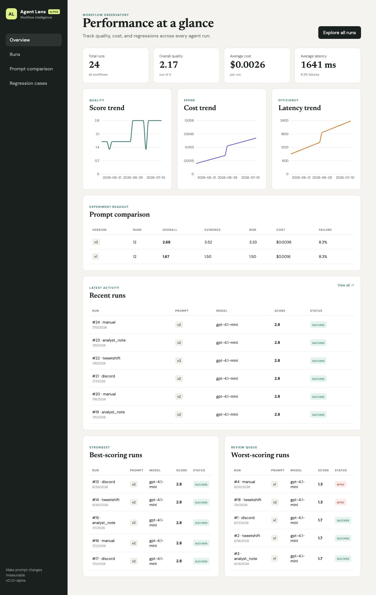
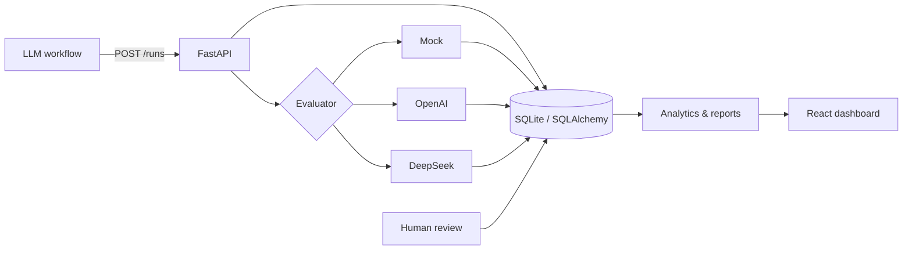

# Agent Lens

[English](README.md) · [简体中文](README.zh-CN.md)

### Did the new prompt actually improve the report?

A self-hosted evaluation dashboard for report-generating LLM workflows. Compare prompt versions, check model scores against human review, and see quality alongside cost, latency, and failures.

[](https://github.com/BrownieCoder/agent-lens/actions/workflows/ci.yml)
[](LICENSE)
[](https://github.com/BrownieCoder/agent-lens/releases/tag/v0.1.0-alpha)

**Python / FastAPI · React / TypeScript · SQLAlchemy / SQLite**

Early alpha. The local demo runs without API keys; hosted evaluators are optional.

[Try the demo](#quick-start) · [Engineering highlights](#engineering-highlights) · [Architecture](#architecture) · [Deployment boundaries](#current-boundaries)

## Engineering highlights

| Design choice | Why it matters | Explore the implementation |
|---|---|---|
| Validated evaluator contracts | Mock, OpenAI, and DeepSeek outputs share one schema; invalid provider output is rejected before persistence. | [Evaluator service](backend/app/services/evaluator.py) · [API tests](backend/tests/test_api.py) |
| Human review with provenance | Blind ratings reference an exact evaluation. Rerunning the judge cannot silently change the comparison. | [Review API](backend/app/routers/human_reviews.py) · [Review queue](frontend/src/pages/ReviewQueue.tsx) |
| Calibration within a defined scope | Metrics use one evaluator model and rubric version, with one human consensus per evaluation. | [Calibration service](backend/app/services/calibration.py) |
| Reproducible local experiments | Paired synthetic cases and a deterministic mock evaluator make the evaluation loop inspectable without paid API calls. | [Demo seed](backend/seed.py) · [Verification](#verification) |

<details>
<summary><strong>View the dashboard</strong> — synthetic demo data</summary>



The screenshot shows an earlier alpha dashboard. Its values are demo data, not production results or model benchmarks.

</details>

## Background

I built Agent Lens while working on an `x-signal-agent` experiment that turns market signals into short research notes. Traces helped me debug execution; I also needed to judge the resulting report after changing a prompt or model. The app focuses on one loop:

```text
output → evaluation → comparison → prompt change
```

The sample data still reflects that original financial-research use case. The storage and API layers do not depend on it, so other report-style workflows can use the same run and evaluation model.

## What works today

- Store workflow inputs, outputs, model metadata, token usage, cost, latency, and errors.
- Score reports across seven dimensions and flag six common review risks.
- Run evaluations offline with the deterministic mock evaluator, or use OpenAI and DeepSeek.
- Compare prompt versions and keep difficult inputs as regression cases.
- Add blind human ratings tied to exact evaluator results and measure judge calibration.
- Export a Markdown evaluation summary for experiment notes.

## Demo

`make seed` creates 24 runs against 12 paired cases and adds eight synthetic human reviews. The `v1` outputs are intentionally vague; `v2` adds evidence, risks, and a next action. This makes the comparison and calibration screens useful immediately, without spending API credits.

## Quick start

Requirements: macOS/Linux, Python 3.11+, Node.js 20+, and `make`. `make setup` installs exact Python transitive versions and the npm lock.

```bash
git clone https://github.com/BrownieCoder/agent-lens.git
cd agent-lens
make setup
cp .env.example backend/.env
make seed
make dev
```

Open:

- Dashboard: `http://localhost:5173`
- API docs: `http://localhost:8000/docs`
- Health check: `http://localhost:8000/health`

`make dev` runs the backend and frontend together. You can also run `make backend` and `make frontend` in separate terminals.

## Evaluators

The default is `mock`, so a fresh clone works without credentials.

| Backend | Key required | Output contract | Intended use |
|---|---|---|---|
| `mock` | No | Deterministic Pydantic payload | Local demo, tests, offline development |
| `openai` | `OPENAI_API_KEY` | Strict JSON Schema | Hosted evaluator |
| `deepseek` | `DEEPSEEK_API_KEY` | JSON mode + Pydantic validation | Hosted evaluator |

Configure the default in `backend/.env`:

```dotenv
EVALUATOR_BACKEND=deepseek
DEEPSEEK_API_KEY=your_key
DEEPSEEK_EVALUATOR_MODEL=deepseek-v4-flash
```

Or override it for one request:

```bash
curl -X POST http://localhost:8000/runs/1/evaluate \
  -H 'Content-Type: application/json' \
  -d '{"evaluator_type":"deepseek","request_id":"replace-with-a-new-unique-request-id"}'
```

Provider calls incur provider charges. Model-produced JSON is always validated before persistence; malformed or empty provider output returns HTTP `502` instead of being stored.

To make one real provider request with synthetic input, without starting the app or writing to its database:

```bash
make smoke-provider                   # DeepSeek
make smoke-provider PROVIDER=openai   # OpenAI
```

The command reads the corresponding key from `backend/.env`, prints only the provider, model, score, review flag, and schema status, and exits non-zero if the provider response is invalid.

## Human review and calibration

Start human judgment from the dedicated **Blind review** queue. It deliberately omits evaluator scores, flags, rankings, and model-priority sorting; the general Runs and analytics pages are not blind entry points. The run page first uses a score-free detail payload and pins the selected evaluation ID in the URL; only after the local human rating exists does it fetch model scores. This is presentation-level blinding, not permission isolation: other analytics APIs remain accessible to the same trusted operator. The review is bound to that exact `evaluation_id`, so rerunning an evaluator cannot silently change the calibration pair. After the blind rating, the reviewer can compare scores and accept, adjust, or reject the model assessment.

The Calibration page aggregates one human consensus per evaluation. It defines signed error as `model − human` and reports:

- MAE and RMSE for absolute error magnitude.
- Bias, where a positive value means the evaluator scores higher than people.
- Agreement rate for an absolute score gap of 0.5 or less.
- Large-disagreement rate for an absolute gap of 1.0 or more.
- Pearson correlation when at least two non-constant pairs exist.
- High-risk cases where evaluator overall is at least 4.0 and human consensus is at most 2.5.

Human ratings are calibration evidence, not automatic ground truth. Multiple reviews of one evaluation are averaged before that evaluation enters aggregate metrics, preventing heavily reviewed samples from receiving extra weight.

Calibration is scoped to one `evaluator_model`, one judge rubric version and one human `rubric_version`; incompatible judge or rubric populations are never averaged together. Evaluation coverage counts reviewed evaluator results over all evaluator results in that model scope. The acceptance rate is reviewer-level: `agree / (agree + adjust + reject)`, excluding pending reviews. Editing a score after model reveal resets its decision to pending, preserves the initial score snapshot and excludes that review from independent blind-calibration metrics. Legacy edited scores without a recoverable original remain explicitly unknown. Reviewer and review-rubric identities cannot be reassigned by editing.

## Interpreting results

- Hosted judges assign six dimension scores and an independent overall judgment, all finite numbers from 1 to 5; overall is not a computed weighted sum. Risk flags are independent indicators. The deterministic mock uses the mean of its six heuristic dimensions minus a 0.3 generic-output penalty, clamped to 1–5; mock scores are demonstrations, not a substitute for a validated judge.
- Evidence scores measure the supplied report's support and citation presentation. No browsing or external fact-verification is performed. Reports are untrusted judge input, never instructions or permission to use tools. Prompt-injection fixtures verify instruction boundaries and parsing, not immunity of a real model.
- Prompt cards are observational cohorts. They show matched and unpaired inputs, repeated runs, generation/judge models and missing provenance; matching alone does not control confounders or establish causation. Scores use each run's latest result; failed runs are included in failure denominators and any scored failures remain in quality summaries. New API evaluations reject failed runs or empty output; previously evaluated failures remain historical evidence. Reruns change the latest-summary population but do not move historical human reviews.
- Generation cost is caller-reported **USD**, not a provider invoice; token/latency fields also come from the caller. Missing measurements are unknown, excluded from means, and accompanied by known-value counts. Judge and retry charges/latency are excluded from generation averages. Mock/seed amounts are synthetic estimates. Upgraded legacy measurements are labeled unverified; old zero values become unknown and leave averages, while their original raw values remain in provenance. Nonzero historical estimates stay included.
- In Overview, apply UTC dates, then **Export displayed summary**. All contributing widgets and the Markdown summary use the applied date scope. Runs search queries the stored dataset and offers pagination; Blind review also offers pages.
- The repository stores run input/output and optional prompt-template hash, generation parameters, dataset and experiment labels. Missing provenance is reported; arbitrary prompt labels do not prove identical templates. See the controlled [experiment fixture](docs/EXPERIMENT.md) for exploration/holdout separation.

Provider requests have a 60-second timeout, no automatic SDK retries and a 2,000-token output cap. A failed or ambiguous attempt must not silently become successful evidence or trigger another paid call. Keep the same `request_id` for a retry; an intentional new evaluation needs a new ID. Inspect attempt status before repeating a timed-out request. A provider may charge even when no valid result is returned. No real provider call or human effectiveness result is implied by passing offline tests.

## Architecture



```text
backend/app/
  models/       Run, evaluation, human-review, and regression entities
  routers/      Run, evaluation, human-review, dashboard, regression, and report APIs
  services/     Evaluators, calibration, analytics, and Markdown export
  schemas/      Validated request and response contracts
frontend/src/
  pages/        Dashboard, runs, prompt comparison, regression, calibration
  components/   Score cards, charts, tables, evaluation and human-review panels
```

## API overview

| Method | Endpoint | Purpose |
|---|---|---|
| POST | `/runs` | Log a workflow run |
| GET | `/runs` | Filter and list runs |
| GET | `/runs/{id}` | Inspect a run and its evaluations |
| POST | `/runs/{id}/evaluate` | Run Mock, OpenAI, or DeepSeek evaluation; use a stable request ID for retries |
| GET | `/runs/{id}/blind` | Score-free input/output and exact selected evaluation metadata |
| GET | `/runs/{id}/evaluation-attempts` | Inspect safe attempt states without raw provider responses |
| GET | `/runs/{id}/evaluation` | Fetch the latest evaluation |
| POST/GET | `/runs/{id}/human-reviews` | Create or list reviews bound to an evaluation |
| GET/PUT | `/human-reviews/{id}` | Read or update one human review |
| GET | `/human-review-queue` | List latest evaluations waiting for review |
| GET | `/dashboard/summary` | Aggregate KPI summary |
| GET | `/dashboard/trends` | Daily quality, cost, and latency trends |
| GET | `/dashboard/prompt-comparison` | Compare prompt versions |
| GET | `/dashboard/ranked-runs` | Find best and worst runs |
| GET | `/dashboard/calibration` | Compare evaluator scores with human consensus |
| GET | `/dashboard/calibration/scopes` | List available evaluator-model and rubric scopes |
| POST/GET | `/regression-cases` | Create or list regression cases |
| GET | `/regression-cases/{id}/runs` | Compare runs linked to one case |
| POST | `/reports/evaluation-summary` | Export a Markdown summary |

## Verification

```bash
make check
```

This runs backend tests, Python compilation, the frontend build, and the npm audit. CI runs the same checks on supported feature-branch pushes and pull requests. A passing historical run is not current acceptance: release candidates also require [the frozen contract](docs/ACCEPTANCE_CONTRACT.md), [fresh independent reviews](docs/DELIVERY_WORKFLOW.md), actual browser verification and recovery checks.

## Current boundaries

This candidate supports one operator, loopback-bound services, one backend worker and local SQLite with non-sensitive data. Direct LAN/public serving is unsupported; remote access requires authenticated SSH forwarding. It does not include authentication, authorization, multi-tenancy, automatic redaction, rate limiting or encryption at rest. Host/Origin and request-size guards reduce accidental exposure but are not authentication. Reviewer labels are unverified local identifiers. Supported alpha schemas have a transactional startup upgrade; general-purpose migrations/Alembic and automatic downgrade are not provided. See [SECURITY.md](SECURITY.md) and [installation, backup, upgrade and rollback](docs/OPERATIONS.md).

LLM-as-judge output is a signal, not ground truth. Calibrate scoring against human review before using it for high-stakes decisions.

## Roadmap

- Pairwise output comparison
- Dataset and experiment versioning
- Alembic migrations and Postgres production profile
- OpenTelemetry trace ingestion
- CI quality gates for Prompt regressions

See [PLAN.md](PLAN.md) for implementation notes and open questions.

## Project notes

- Contributions: [CONTRIBUTING.md](CONTRIBUTING.md)
- Changelog: [CHANGELOG.md](CHANGELOG.md)
- Release checklist: [docs/RELEASE_CHECKLIST.md](docs/RELEASE_CHECKLIST.md)
- License: [MIT](LICENSE)
